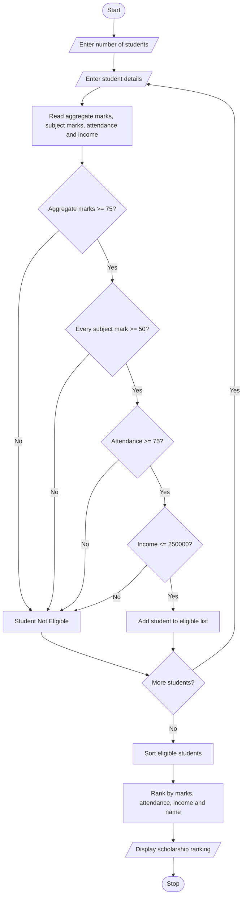

# University Scholarship Allocation System Using Python

## 1. Problem Statement

The University Scholarship Allocation System is designed to identify and select eligible students for scholarships based on their academic performance, attendance, and family income.

The system evaluates each student's aggregate marks, subject-wise minimum marks, attendance percentage, and annual family income. Students who satisfy all the eligibility criteria are considered eligible for the scholarship.

After checking eligibility, the system ranks eligible students based on their aggregate marks in descending order. If two or more students have the same aggregate marks, predefined tie-breaking rules are applied:

1. Students with higher attendance are given priority.
2. If attendance is also equal, students with higher family income? No — students with lower family income are given priority.
3. If all criteria are equal, the student's name is used for alphabetical ordering.

The system generates a final list of eligible students in ranked order.

## 2. Algorithm

Step 1: Start the program.

Step 2: Read the total number of students.

Step 3: For each student, accept the following details:

- Student name
- Aggregate marks
- Subject-wise marks
- Attendance percentage
- Annual family income

Step 4: Check the eligibility conditions:

- Aggregate marks must be at least 75%.
- Each subject mark must be at least 50%.
- Attendance must be at least 75%.
- Annual family income must not exceed ₹2,50,000.

Step 5: If all conditions are satisfied, mark the student as eligible.

Step 6: Store all eligible students in a list.

Step 7: Sort eligible students using the following priority:

- Higher aggregate marks.
- Higher attendance.
- Lower family income.
- Alphabetical order of name.

Step 8: Display the ranked list of eligible students.

Step 9: If no students are eligible, display an appropriate message.

Step 10: Stop the program.
## 3.flowchart

## 5. Sample Input

Enter number of students: 4

Enter details of Student 1
Enter student name: Harini
Enter aggregate marks: 90
Enter number of subjects: 3
Enter marks in subject 1: 85
Enter marks in subject 2: 92
Enter marks in subject 3: 90
Enter attendance percentage: 95
Enter annual family income: 200000

Enter details of Student 2
Enter student name: Priya
Enter aggregate marks: 85
Enter number of subjects: 3
Enter marks in subject 1: 80
Enter marks in subject 2: 85
Enter marks in subject 3: 90
Enter attendance percentage: 90
Enter annual family income: 180000

Enter details of Student 3
Enter student name: Rahul
Enter aggregate marks: 90
Enter number of subjects: 3
Enter marks in subject 1: 90
Enter marks in subject 2: 88
Enter marks in subject 3: 92
Enter attendance percentage: 98
Enter annual family income: 220000

Enter details of Student 4
Enter student name: Sneha
Enter aggregate marks: 70
Enter number of subjects: 3
Enter marks in subject 1: 75
Enter marks in subject 2: 80
Enter marks in subject 3: 70
Enter attendance percentage: 85
Enter annual family income: 150000

## 6. Sample Output

Harini is Eligible for Scholarship

Priya is Eligible for Scholarship

Rahul is Eligible for Scholarship

Sneha is Not Eligible for Scholarship

===== SCHOLARSHIP ALLOCATION RESULTS =====

Rank  Name       Aggregate  Attendance  Income

1     Rahul      90.0       98.0        220000.0
2     Harini     90.0       95.0        200000.0
3     Priya      85.0       90.0        180000.0

Scholarship allocation process completed

