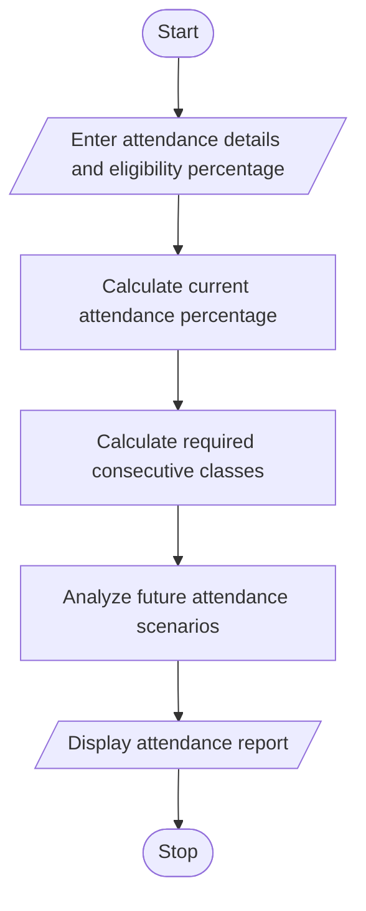

# 12. Attendance Recovery Computation Using Python

## 1. Problem Statement

Develop a Python program to calculate a student's current attendance percentage and determine the minimum number of consecutive classes they must attend to reach a required eligibility threshold. The program should also analyze different future attendance scenarios, such as attending all upcoming classes or attending only a certain percentage of them.

## 2. Algorithm

1. Start.
2. Enter the total classes conducted.
3. Enter the number of classes attended.
4. Enter the required attendance percentage.
5. Calculate the current attendance percentage.
6. Enter the number of future classes.
7. Calculate the minimum consecutive classes required to reach the eligibility threshold.
8. Analyze different future attendance scenarios.
9. Display the attendance report.
10. Stop.

## 3. Flowchart

## 5. Sample Input

Enter total classes conducted: 100
Enter classes attended: 65
Enter required attendance percentage: 75

Enter upcoming number of classes: 20

## 6. Sample Output

===== ATTENDANCE REPORT =====
Total Classes: 100
Classes Attended: 65
Current Attendance: 65.0 %

Eligibility Status: Not yet eligible
Minimum Consecutive Classes Required: 40

===== FUTURE ATTENDANCE SCENARIOS =====

Future Attendance: 100 %
Classes Attended: 20
Projected Attendance: 70.83 %
Status: Not Eligible

Future Attendance: 80 %
Classes Attended: 16
Projected Attendance: 67.5 %
Status: Not Eligible

Future Attendance: 50 %
Classes Attended: 10
Projected Attendance: 62.5 %
Status: Not Eligible

Attendance analysis completed.

