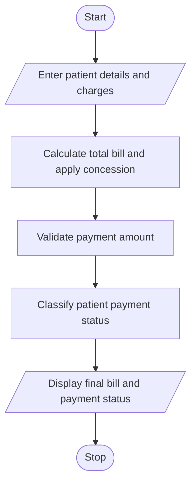

#  Hospital Billing and Patient Classification Using Python

## 1. Problem Statement

The Hospital Billing and Patient Classification System is designed to calculate patient bills based on consultation, diagnostic, and treatment charges.

The system accepts patient details and calculates the total hospital bill. It applies conditional concessions based on patient category, validates billing constraints, and classifies patients according to the payment policy.

The system performs the following operations:

- Accept patient details and service charges.
- Calculate consultation, diagnostic, and treatment charges.
- Apply concessions for eligible patients.
- Validate billing details and payment constraints.
- Calculate the final payable amount.
- Classify patients based on their payment status.

## 2. Algorithm

1. Start the program.
2. Enter the patient name and patient category.
3. Enter consultation, diagnostic, and treatment charges.
4. Validate that all charges are non-negative.
5. Calculate the total bill.
6. Apply a 20% concession for senior citizens and a 10% concession for students.
7. Calculate the final payable amount.
8. Enter the amount paid by the patient.
9. Validate that the paid amount does not exceed the final bill.
10. Classify the patient:

- Fully Paid: Entire bill is paid.
- Partially Paid: Some amount is paid.
- Unpaid: No amount is paid.

11. Display the final bill, concession, and payment classification.
12. Stop the program.

## 3. Flowchart 

## 5.Sample Input
Enter patient name: Harini
Enter patient category (Normal/Senior/Student): Senior

Enter consultation charges: 500
Enter diagnostic charges: 1000
Enter treatment charges: 2500

Enter amount paid: 2500

## 6. Sample Output

===== HOSPITAL BILL =====

Patient Name: Harini
Total Bill: Rs. 4000.0
Concession: Rs. 800.0
Final Bill: Rs. 3200.0

Enter amount paid: 2500

===== PAYMENT DETAILS =====

Amount Paid: Rs. 2500.0
Remaining Balance: Rs. 700.0
Patient Classification: Partially Paid

Billing process completed.

