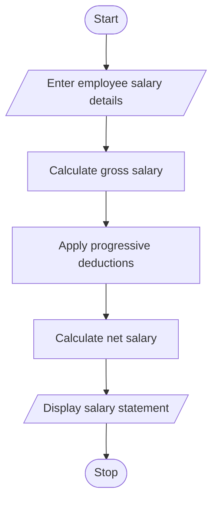

#  Employee Payroll and Deduction Analysis Using Python

## 1. Problem Statement

The Employee Payroll and Deduction Analysis System is designed to calculate the monthly salary of employees based on their basic pay, allowances, overtime, and incentives.

The system calculates the gross salary, applies progressive deductions based on salary ranges, and determines the final net salary. It also generates a formatted salary statement containing all salary details and deductions.

The system performs the following operations:

- Accept employee details and basic salary.
- Calculate allowances, overtime, and incentives.
- Calculate gross salary.
- Apply progressive deductions.
- Calculate net salary.
- Generate a formatted salary statement.

## 2. Algorithm

1. Start the program.
2. Enter employee name and basic salary.
3. Enter allowances, overtime hours, overtime rate, and incentives.
4. Calculate overtime pay.
5. Calculate gross salary.
6. Apply progressive deductions:
   - First ₹10,000: 5%.
   - Next ₹10,000: 10%.
   - Above ₹20,000: 15%.
7. Calculate total deductions.
8. Calculate net salary.
9. Display the formatted salary statement.
10. Stop the program.

## 3. Flowchart 

## 5.Sample Input

Enter employee name: Harini
Enter basic salary: 20000
Enter allowances: 5000
Enter overtime hours: 10
Enter overtime rate: 200
Enter incentives: 3000

## 6. Sample Output

========== SALARY STATEMENT ==========

Employee Name       : Harini
Basic Salary        : Rs. 20000.0
Allowances          : Rs. 5000.0
Overtime Pay        : Rs. 2000.0
Incentives          : Rs. 3000.0
--------------------------------------
Gross Salary        : Rs. 30000.0
Total Deductions    : Rs. 3500.0
--------------------------------------
Net Salary          : Rs. 26500.0
======================================

