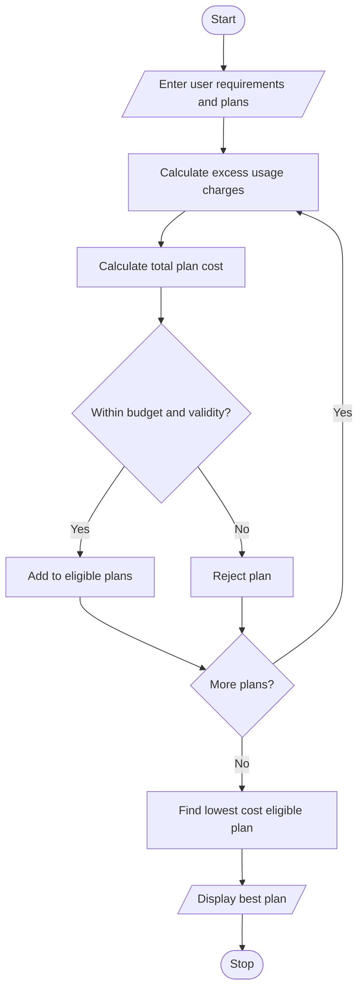

#  Multi-Plan Telecommunications Cost Optimization Using Python

## 1. Problem Statement

The Multi-Plan Telecommunications Cost Optimization System is designed to compare different mobile recharge plans based on user requirements.

The system considers data usage, call minutes, plan validity, and budget constraints. It calculates the total cost of each plan, including excess usage charges when the user's consumption exceeds the plan limits.

The system performs the following operations:

- Accept user requirements such as data usage, call minutes, validity, and budget.
- Accept details of multiple mobile plans.
- Calculate excess data and call charges.
- Calculate the total cost of each plan.
- Check whether each plan satisfies the budget and validity constraints.
- Identify the most economical eligible plan.
- Display the best mobile plan.

## 2. Algorithm

1. Start the program.
2. Enter the user's data usage, call minutes, required validity, and budget.
3. Enter the number of available mobile plans.
4. Enter the details of each plan:
   - Plan name
   - Data limit
   - Call limit
   - Validity
   - Plan price
   - Excess data charge
   - Excess call charge
5. Calculate excess data and call usage.
6. Calculate additional charges.
7. Calculate the total cost of each plan.
8. Check validity and budget constraints.
9. Store all eligible plans.
10. Select the plan with the lowest total cost.
11. Display all plan details and the most economical eligible plan.
12. Stop the program.

## 3. Flowchart 

## 5.Sample Input


Enter required data (GB): 2
Enter required call minutes: 100
Enter required validity (days): 28
Enter your budget: 300

Enter number of mobile plans: 3

Enter details of Plan 1
Enter plan name: Basic
Enter data limit (GB): 1
Enter call limit (minutes): 80
Enter validity (days): 28
Enter plan price: 150
Enter excess data charge per GB: 50
Enter excess call charge per minute: 1

Enter details of Plan 2
Enter plan name: Standard
Enter data limit (GB): 2
Enter call limit (minutes): 100
Enter validity (days): 56
Enter plan price: 249
Enter excess data charge per GB: 50
Enter excess call charge per minute: 1

Enter details of Plan 3
Enter plan name: Premium
Enter data limit (GB): 3
Enter call limit (minutes): 150
Enter validity (days): 84
Enter plan price: 399
Enter excess data charge per GB: 50
Enter excess call charge per minute: 1
```

## 6. Sample Output

```
Plan: Basic
Total Cost: Rs. 220.0
Status: Eligible

Plan: Standard
Total Cost: Rs. 249.0
Status: Eligible

Plan: Premium
Total Cost: Rs. 399.0
Status: Not Eligible

===== PLAN COMPARISON =====

Rank: 1
Plan Name: Basic
Total Cost: Rs. 220.0
Validity: 28 days

Rank: 2
Plan Name: Standard
Total Cost: Rs. 249.0
Validity: 56 days

===== BEST MOBILE PLAN =====
Plan Name: Basic
Minimum Cost: Rs. 220.0
Validity: 28 days

Plan optimization completed.


