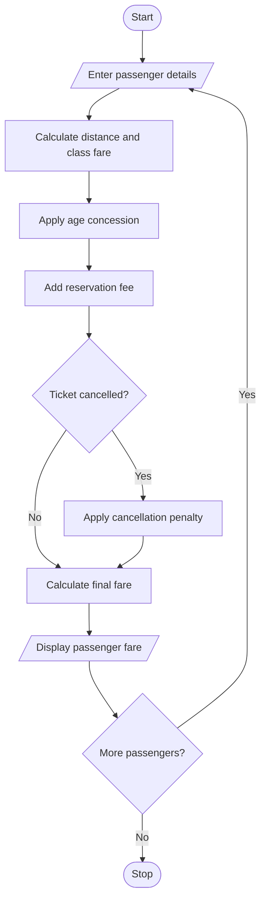

#  Railway Fare and Reservation Calculator Using Python

## 1. Problem Statement

The Railway Fare and Reservation Calculator is designed to calculate railway ticket fares for multiple passengers based on travel distance, travel class, age-based concessions, reservation fees, and cancellation penalties.

The system accepts passenger details, calculates the basic fare according to distance slabs and travel class, applies eligible age-based concessions, and adds reservation fees. It also calculates cancellation charges according to predefined cancellation rules.

The system performs the following operations:

- Accept passenger details and journey distance.
- Calculate fares using different distance slabs.
- Apply travel-class charges.
- Provide age-based concessions.
- Add reservation fees.
- Calculate cancellation penalties when applicable.
- Display the final fare for each passenger.

## 2. Algorithm

1. Start the program.
2. Enter the number of passengers.
3. Enter passenger name, age, travel distance, and travel class.
4. Calculate the basic fare based on distance slabs:
   - First 100 km: ₹1 per km.
   - Next 100 km: ₹1.5 per km.
   - Above 200 km: ₹2 per km.
5. Apply class charges:
   - Sleeper: 1.0 times.
   - AC 3 Tier: 1.5 times.
   - AC 2 Tier: 2.0 times.
6. Apply age-based concessions:
   - Children below 5 years: Free.
   - Senior citizens aged 60 or above: 20% concession.
7. Add reservation fee of ₹40.
8. Ask whether the ticket is cancelled.
9. If cancelled, apply a 20% cancellation penalty.
10. Calculate the final payable amount.
11. Display the passenger-wise fare details.
12. Stop the program.

## 3. Flowchart (Mermaid)



## 5. Sample Input


Enter number of passengers: 2

Passenger 1
Enter passenger name: Harini
Enter age: 22
Enter travel distance in km: 250
Enter travel class: AC3
Cancel ticket? (yes/no): no

Passenger 2
Enter passenger name: Priya
Enter age: 65
Enter travel distance in km: 150
Enter travel class: Sleeper
Cancel ticket? (yes/no): yes


## 6. Sample Output

```
===== RAILWAY FARE DETAILS =====

Passenger Name: Harini
Age: 22
Travel Distance: 250.0 km
Travel Class: AC3
Basic Fare: Rs. 275.0
Concession: Rs. 0
Reservation Fee: Rs. 40
Cancellation Penalty: Rs. 0
Final Amount: Rs. 452.5
Ticket Status: Confirmed


===== RAILWAY FARE DETAILS =====

Passenger Name: Priya
Age: 65
Travel Distance: 150.0 km
Travel Class: SLEEPER
Basic Fare: Rs. 175.0
Concession: Rs. 35.0
Reservation Fee: Rs. 40
Cancellation Penalty: Rs. 36.0
Final Amount: Rs. 36.0
Ticket Status: Cancelled

Railway booking process completed.


