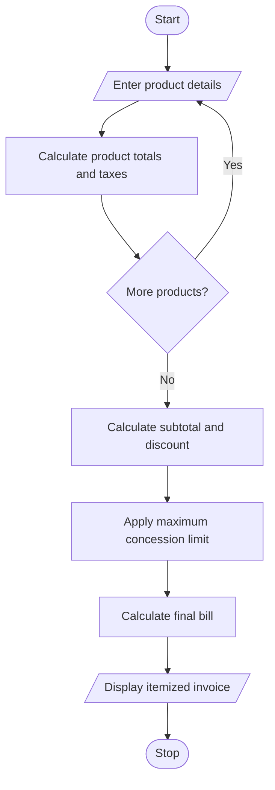

#  Retail Billing with Multiple Discount Rules Using Python

## 1. Problem Statement

The Retail Billing System is designed to generate itemized invoices for customers purchasing multiple products.

The system calculates the total price based on product prices and quantities. It applies category-specific taxes, threshold-based discounts, and maximum concession limits to determine the final bill amount.

The system performs the following operations:

- Accept multiple product names, prices, quantities, and categories.
- Calculate the total price of each product.
- Apply category-specific taxes.
- Apply discounts based on purchase amount.
- Limit discounts according to the maximum concession allowed.
- Calculate the final payable amount.
- Generate an itemized invoice.

## 2. Algorithm

1. Start the program.
2. Enter the number of products.
3. Enter product name, category, price, and quantity.
4. Calculate the total price of each product.
5. Apply category-specific taxes:
   - Electronics: 18%.
   - Clothing: 5%.
   - Grocery: 2%.
6. Calculate the subtotal.
7. Apply threshold discounts:
   - Above ₹5,000: 10% discount.
   - Above ₹10,000: 15% discount.
8. Limit the maximum discount to ₹2,000.
9. Calculate the final bill after adding taxes and subtracting discounts.
10. Display the itemized invoice.
11. Stop the program.

## 3. Flowchart (Mermaid)

## 5. Sample Input

Enter number of products: 3

Product 1
Enter product name: Laptop
Enter category: electronics
Enter price: 40000
Enter quantity: 1

Product 2
Enter product name: Shirt
Enter category: clothing
Enter price: 1000
Enter quantity: 2

Product 3
Enter product name: Rice
Enter category: grocery
Enter price: 500
Enter quantity: 2

## 6. Sample Output

========== RETAIL INVOICE ==========

Product       Category    Qty    Amount    Tax

Laptop        electronics 1      40000.0   7200.0
Shirt         clothing    2       2000.0    100.0
Rice          grocery     2       1000.0     20.0

------------------------------------
Subtotal       : Rs. 43000.0
Total Tax      : Rs. 7320.0
Discount       : Rs. 2000.0
------------------------------------
Final Bill     : Rs. 48320.0
====================================

Thank you for shopping!

