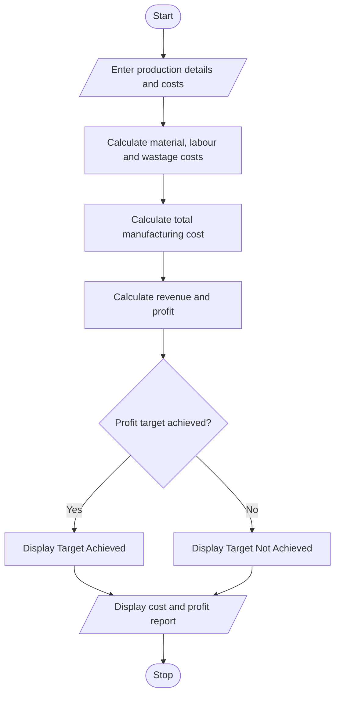

# 8. Manufacturing Cost and Profitability Analysis Using Python

## 1. Problem Statement

The Manufacturing Cost and Profitability Analysis System is designed to calculate the total production cost and profit of manufactured products.

The system considers material costs, labour charges, wastage costs, machine costs, and selling prices to determine the total manufacturing cost and profitability.

It also compares the calculated profit percentage with a specified profit target to identify whether the production meets the expected profit level.

The system performs the following operations:

- Accept product details and production quantity.
- Calculate material costs.
- Calculate labour charges.
- Calculate wastage costs.
- Calculate machine costs.
- Calculate total manufacturing cost.
- Calculate selling price and profit.
- Check whether the specified profit target is achieved.
- Display the final cost and profitability report.

## 2. Algorithm

1. Start the program.
2. Enter product name and production quantity.
3. Enter material cost per unit.
4. Enter labour cost per unit.
5. Enter wastage percentage.
6. Enter machine cost per unit.
7. Enter selling price per unit.
8. Calculate total material cost.
9. Calculate total labour cost.
10. Calculate wastage cost.
11. Calculate total machine cost.
12. Calculate total manufacturing cost.
13. Calculate total selling revenue and profit.
14. Calculate profit percentage.
15. Compare profit percentage with the target.
16. Display the profitability report.
17. Stop the program.
## 3.Flowchart

## 5. Sample Input

Enter product name: Chairs

Enter production quantity: 100

Enter material cost per unit: 200
Enter labour cost per unit: 50
Enter wastage percentage: 10
Enter machine cost per unit: 30
Enter selling price per unit: 400

Enter target profit percentage: 20

## 6. Sample Output

===== MANUFACTURING REPORT =====

Product Name       : Chairs
Production Quantity: 100

----- COST DETAILS -----
Material Cost      : Rs. 20000.0
Labour Cost        : Rs. 5000.0
Wastage Cost       : Rs. 2000.0
Machine Cost       : Rs. 3000.0

Total Cost         : Rs. 30000.0
Total Revenue      : Rs. 40000.0
Total Profit       : Rs. 10000.0
Profit Percentage  : 33.33 %

Profitability Status: Profit Target Achieved

Manufacturing analysis completed.

