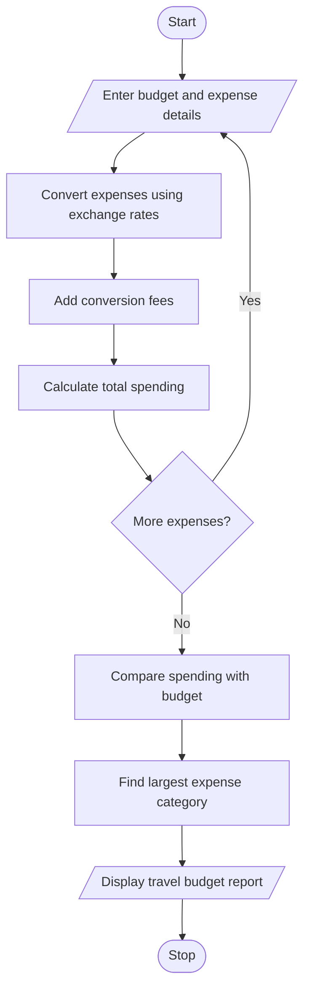

# 9. Multi-Currency Travel Budget Analysis Using Python

## 1. Problem Statement

The Multi-Currency Travel Budget Analysis System is designed to calculate and manage travel expenses in different currencies.

The system accepts travel expenses in multiple currencies and converts them into a common base currency using supplied exchange rates. It also includes currency conversion fees, compares total spending against the planned travel budget, and identifies the largest expense category.

The system performs the following operations:

- Accept travel expenses and their categories.
- Accept different currencies and exchange rates.
- Convert expenses into the base currency.
- Calculate currency conversion fees.
- Calculate total travel expenses.
- Compare actual spending with the planned budget.
- Identify the largest expense category.
- Display the final travel budget report.

## 2. Algorithm

1. Start the program.
2. Enter the travel budget in the base currency.
3. Enter the currency conversion fee percentage.
4. Enter the number of travel expenses.
5. Enter expense category, amount, currency, and exchange rate.
6. Convert each expense into the base currency.
7. Calculate the conversion fee.
8. Calculate the total expense including conversion fees.
9. Store expenses category-wise.
10. Calculate total travel spending.
11. Compare total spending with the planned budget.
12. Identify the largest expense category.
13. Display the travel budget report.
14. Stop the program.

## 3. Flowchart 

## 5. Sample Input

Enter travel budget in INR: 50000
Enter conversion fee percentage: 2
Enter number of expenses: 4

Expense 1
Enter expense category: Hotel
Enter expense amount: 100
Enter currency code: USD
Enter exchange rate to INR: 85

Expense 2
Enter expense category: Food
Enter expense amount: 50
Enter currency code: USD
Enter exchange rate to INR: 85

Expense 3
Enter expense category: Transport
Enter expense amount: 3000
Enter currency code: INR
Enter exchange rate to INR: 1

Expense 4
Enter expense category: Shopping
Enter expense amount: 100
Enter currency code: EUR
Enter exchange rate to INR: 90

## 6. Sample Output

Expense 1
Currency: USD
Converted Amount: Rs. 8500.0
Conversion Fee: Rs. 170.0
Total Expense: Rs. 8670.0

Expense 2
Currency: USD
Converted Amount: Rs. 4250.0
Conversion Fee: Rs. 85.0
Total Expense: Rs. 4335.0

Expense 3
Currency: INR
Converted Amount: Rs. 3000.0
Conversion Fee: Rs. 60.0
Total Expense: Rs. 3060.0

Expense 4
Currency: EUR
Converted Amount: Rs. 9000.0
Conversion Fee: Rs. 180.0
Total Expense: Rs. 9180.0

===== TRAVEL BUDGET REPORT =====

Planned Budget: Rs. 50000.0
Total Spending: Rs. 25245.0
Budget Status: Within Budget
Remaining Budget: Rs. 24755.0

Largest Expense Category: Shopping

Expense Details:
Hotel : Rs. 8670.0
Food : Rs. 4335.0
Transport : Rs. 3060.0
Shopping : Rs. 9180.0

Travel budget analysis completed.

